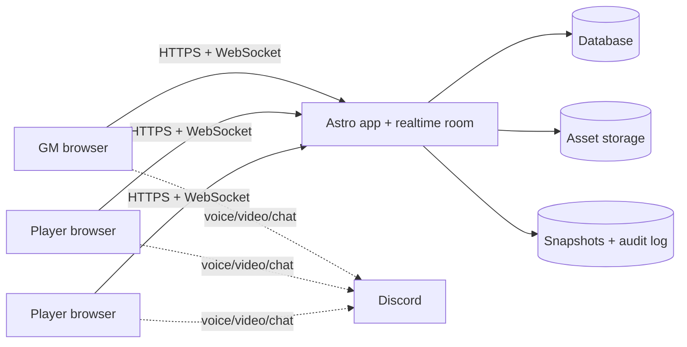

# GMTool — Development Plan

> **Note:** This is the long-form design reference. The working plan for the current alpha is
> `MVP_OUTLINE.md`, and the implemented stack is documented in `ALPHA_IMPLEMENTATION.md`.

**Status:** Draft for review  
**Last updated:** 2026-11-22  
**Target:** A private, low-cost GM and player workspace for running Daggerheart sessions online

---

## 1. Executive Summary

GMTool replaces the current patchwork of Discord screen sharing, Google Slides, Dungeondraft maps, D&D Beyond sheets, and scattered notes with one persistent campaign workspace.

The first release should **not** try to become a full virtual tabletop. It should do four things well:

1. Let the GM build reusable **Frames**, run them as **Campaigns**, and play them one **Session** at a time.
2. Give the table a shared battlemap/whiteboard with tokens, colored pointers, and simple GM-approved movement.
3. Give players a minimal character sheet and persistent character-bound notes.
4. Preserve campaign history through automatic snapshots, checkpoints, and rollback.

Discord remains the voice, video, and text-chat layer for v1. The app owns the shared table state, campaign preparation, character continuity, and GM tools.

### Recommended v0.1 test product

- Frame, Campaign, Scene, and Session management.
- Launch/join using a session link plus a 6-digit PIN.
- Player character claiming via a browser claim token, with a GM-issued reclaim code.
- Active scene display with optional grid, token placement, and colored pointers.
- Player token movement up to 10 ft per turn, with GM Pass/Fail approval when a move exceeds the allowance or a second move is attempted.
- GM-only NPC/enemy token control.
- Minimal character sheet: portrait, name, current/max HP, description, private notes.
- Shared party journal.
- Fear tracker, labeled countdowns, and dice roller (Duality Dice plus standard dice).
- Automatic session draft saving, checkpoint snapshots, auto-commit at session end, and restore-any-snapshot.
- Link/PIN rotation that invalidates a compromised link without losing committed campaign history.

### Recommended launch product (v1.0)

Everything above, plus:

- Full guided Daggerheart character builder using SRD 2.0 content, including Hope & Fear options.
- Interactive character sheet with Hope, Fear, HP, Armor, Stress, equipment, domain cards, actions, and a level guide.
- Better onboarding, export/import, accessibility, and hardened security.
- Optional scene hotspots with GM-only versus player-visible information.
- A tested 7-player session with backups and a recovery drill.

### Cost target

The test product should run at **$0/month** on permanent free tiers, with a clear escape hatch to a ~$5/month managed plan or a self-hosted Docker server. No free trials should be part of the critical path.

---

## 2. Product Goals and Non-Goals

### Goals

- Make campaign prep reusable through Frames.
- Make joining a session trivial for new players.
- Give the GM control over scene progression, secrets, and disputed movement.
- Give players agency over their own character, token, pointers, HP, and notes.
- Keep the live table state synchronized across 5–7 participants.
- Preserve campaign state across sessions and recover cleanly from mistakes or leaked links.
- Collect as little user data as possible. No email, password, phone number, or real-name requirement.
- Keep the system understandable and maintainable by a solo builder with AI assistance.

### Non-goals for v0.1

- Full Daggerheart rules automation.
- Full character builder or rules compendium.
- Built-in voice, video, or screen sharing.
- Built-in text chat.
- Freehand drawing or rich collaborative document editing.
- Fog of war, dynamic lighting, walls, or line-of-sight.
- Mobile/touch optimization.
- Public signup, multi-tenant accounts, billing, or a marketplace.
- Integration with D&D Beyond, Google Slides, or Dungeondraft beyond image uploads.
- 3D dice, animation-heavy UI, or a full VTT feature race.

### Product thesis

Build only what Discord + slides + a static map cannot do together:

- Persistent Frame/Campaign/Session state.
- A shared board where players can point and move tokens.
- GM approval of contested movement.
- Character-bound notes and HP that survive between sessions.
- Reusable campaign preparation.

Everything else can wait.

---

## 3. Design Principles

1. **One active scene.** The GM sets it; players follow. No player scene browsing.
2. **The GM is the authority.** Players have agency inside clear guardrails.
3. **Session is a working copy.** The campaign is the durable record. Never let a live session destroy campaign history.
4. **Every destructive action is reversible.** Snapshots, revisions, soft deletes, and export.
5. **Minimum data, maximum clarity.** No accounts in v0.1. Collect only what the table needs.
6. **Manual-first rules.** Let the GM adjudicate; automate later only where it saves real effort.
7. **Boring technology.** One app, one database, one real-time room service, one deploy.
8. **Progressive disclosure.** New players see a simple sheet and clear actions; advanced tools stay in the GM drawer.
9. **Optimize for seven people, not seven thousand.** Free-tier limits are acceptable if the design respects them.
10. **License-safe content.** Use the Daggerheart SRD and user-owned assets, not official art, maps, or book text.

---

## 4. Domain Model

The hierarchy is **Frame → Campaign → Session**, with **Snapshots** providing point-in-time recovery.

| Entity | Definition | Contains | Does not contain |
|---|---|---|---|
| **Frame** | A reusable adventure module or template, similar to a published campaign book | Story premise, rules configuration, scene templates, NPC/enemy templates, maps/backgrounds, countdown templates, GM guidance | Player characters, session progress, participant data |
| **Campaign** | One run of a Frame by a specific group | Up to 10 player characters, campaign notes, published scene list, counters, progression, session history, snapshots | The Frame's reusable template state |
| **Session** | One live sitting of a Campaign | Join link/PIN, active scene, live tokens, presence, pointers, session draft, session notes, dice log | Permanent campaign history |
| **Snapshot** | An immutable point-in-time copy of campaign state | Scenes, tokens, character state, counters, notes, progression | Presence, live pointers, connection data |
| **Scene** | A roleplay backdrop or battlemap | Background image or preset, optional grid, tokens, GM notes, player-facing description | Campaign-wide notes |
| **Character** | A playable character in a Campaign | Portrait, name, color, HP, description, private notes, claim state | User account data |
| **Participant** | A connected person in a Session | Display name, color, role, claimed character, connection status | Permanent account identity |

### Naming note

"Daggerheart Campaign Frame" is an official game term. In this app, **Frame** means the reusable module template. A Frame may contain a Daggerheart Campaign Frame, but the app should not copy official Campaign Frame prose, art, or maps unless the license explicitly allows it.

### Versioning rules

- A **Frame** has a draft and immutable published versions.
- A **Campaign pins the Frame version** it was created from.
- Editing a Frame later does not change existing Campaigns.
- A GM may optionally upgrade a Campaign to a newer Frame version; this creates a new Campaign draft revision and requires confirmation.
- Creating a Campaign copies the Frame's scene and NPC templates into editable Campaign records. Editing a Campaign never mutates the Frame.

### Draft, publish, and commit

| Action | Meaning |
|---|---|
| **Publish Frame** | Makes a Frame version available for creating new Campaigns |
| **Publish Campaign** | Makes campaign edits available to launch a Session |
| **Checkpoint Session** | Saves the live session state back to the Campaign as a snapshot without ending play |
| **Commit Session** | Applies session results to the Campaign, creates an end snapshot, and publishes a new Campaign revision |

---

## 5. Roles and Permissions

| Action | Player | GM |
|---|---|---|
| View the active scene | Yes | Yes |
| Browse other scenes | No | Yes |
| Pan/zoom own view | Yes | Yes |
| Use a colored pointer | Yes | Yes, white/gold |
| Move own character token within allowance | Yes, once per turn | Yes, unrestricted |
| Move another player's token | No | Yes |
| Move NPC/enemy tokens | No | Yes |
| Add/remove NPC/enemy tokens | No | Yes |
| Hide/show a token from players | No | Yes |
| Lock the board | No | Yes |
| Pass/Fail a movement request | No | Yes |
| Edit own character HP/description/notes | Yes, if claimed | Yes |
| Edit another character | No | Yes |
| View private character notes | Own character only | Yes, for assistance |
| View GM campaign/scene notes | No | Yes |
| Read/write party journal | Yes | Yes |
| Update Fear/countdowns | No | Yes |
| Roll dice | Yes | Yes |
| See public roll log | Yes | Yes |
| Roll hidden dice | No | Yes |
| Rotate link/PIN | No | Yes |
| Checkpoint/end/restore | No | Yes |
| Publish Frame/Campaign | No | Yes |

### GM visibility of player notes

Recommended: the GM can see player private notes, but the UI should disclose this. The purpose is to help new players and keep the story coherent. If you prefer strict player privacy, change this before implementation; it affects the notes API and UI labels.

---

## 6. Core User Flows

### 6.1 Create a Frame

1. GM opens the GM dashboard and creates a Frame.
2. GM adds a title, description, cover image, rules settings, and scene templates.
3. Each scene template can be a roleplay backdrop or a battlemap with an optional grid.
4. GM adds NPC/enemy templates, countdown templates, and GM-only notes.
5. GM previews the Frame.
6. GM publishes a Frame version.

### 6.2 Create a Campaign from a Frame

1. GM selects a published Frame version.
2. GM creates a Campaign with a title and optional cover.
3. The app copies the Frame's scenes, NPC templates, and counters into the Campaign.
4. GM creates or invites players to create up to 10 playable characters.
5. GM publishes the Campaign revision.

### 6.3 Launch a Session

1. GM opens the Campaign and clicks **Launch Session**.
2. The app creates a pre-session snapshot.
3. The app generates a session link and a 6-digit PIN.
4. The GM selects the starting scene: the first scene, the last scene from the previous session, or a manually chosen scene.
5. The session opens in the GM view.
6. GM shares the link and PIN in Discord.

### 6.4 Join a Session

1. Player opens the link.
2. Player enters the PIN.
3. Player enters a display name and chooses a ring color.
4. Player sees the roster of up to 10 characters.
5. Player selects an unclaimed character or creates a new one.
6. The browser receives a claim token; the character is now claimed.
7. Player enters the session view.

A returning player on the same browser is recognized automatically. A player on a new device can enter the character's one-time reclaim code, or ask the GM to release the claim.

### 6.5 Run the Session

1. GM sets the active scene. Players follow.
2. GM and players use colored pointers.
3. Players move their own tokens within the movement allowance.
4. If a move exceeds the allowance or the player has already moved this turn, the player's board locks and a movement request appears in the GM drawer.
5. GM chooses **Pass** or **Fail**.
6. GM can add/remove NPC and enemy tokens at any time.
7. GM updates Fear and countdowns.
8. Anyone can roll dice; results appear in the shared roll log.
9. Players update their own HP and notes; GM can update any character.
10. GM can checkpoint at any time.

### 6.6 End the Session

1. GM clicks **End Session**.
2. The app freezes writes and creates an end snapshot.
3. The app applies session results to the Campaign.
4. The app publishes a new Campaign revision automatically.
5. The app shows a session summary and keeps a 24-hour undo.
6. Players see a session-ended screen with access to their character notes and the party journal.

### 6.7 Reuse a Frame

1. GM creates a new Campaign from the same published Frame version.
2. The new Campaign gets fresh characters, scenes, and session history.
3. The original Campaign remains untouched.

### 6.8 Recover from a Compromised Link

1. GM clicks **Rotate Link/PIN**.
2. The old link and PIN stop working immediately.
3. Connected non-GM clients are disconnected and must rejoin with the new credentials.
4. GM checkpoints if the current session is trustworthy, or discards the live session.
5. GM restores the most recent good snapshot if needed.
6. GM launches a new session from the restored Campaign state.
7. The GM reviews the audit log and character claims.

**What is lost:** only uncommitted live-session changes since the last checkpoint or end-of-session commit. Campaign history and previous sessions are not lost.

---

## 7. Scope by Version

### 7.1 v0.1 — Test Product

Purpose: validate the live table experience with the real group, not the full ruleset.

**Included**

- Frame CRUD, draft/publish, version pinning.
- Campaign CRUD from a Frame, publish, archive.
- Scene CRUD, background image upload, built-in backgrounds, optional grid.
- Character creation with portrait, name, HP, description, and notes.
- Up to 10 characters per Campaign.
- Character claim/reclaim and GM release.
- Session launch/join with link + PIN.
- GM session view and player session view.
- Left-side drawers for GM tools and player character sheet.
- Active scene sync.
- Tokens: player, NPC, enemy, marker.
- GM add/remove NPC/enemy tokens; hide/show tokens.
- Colored pointers with GM white/gold.
- Player movement rules with GM Pass/Fail.
- Board lock, individual token lock, revert last move.
- Fear tracker, labeled countdowns, dice roller, roll log.
- Private character notes, GM-only campaign/scene notes, shared party journal.
- Autosave, pre-session snapshot, manual checkpoint, end-session commit, restore snapshot.
- Link/PIN rotation.
- Audit log of joins, rotations, checkpoints, restores, and commits.
- Campaign export (JSON + assets).
- Demo Frame with 3 scenes and sample characters.

**Excluded from v0.1**

- Full Daggerheart character builder.
- Hope, Armor, Stress, equipment, domain cards, and level guide.
- Action/spell panel and rules automation.
- Hotspots/hover popups.
- Freehand drawing.
- Fog, lighting, walls, measurement templates.
- Chat, voice, video, screen share.
- Mobile/touch layout.
- Public accounts.
- Frame import (export is enough for v0.1).

### 7.2 v1.0 — Launch Product

Adds:

- Full guided character builder using Daggerheart SRD 2.0, including Hope & Fear classes, ancestries, communities, domains, transformations, equipment, and adversaries as appropriate.
- Interactive sheet with Hope, Fear, HP, Armor, Stress, Evasion, proficiency, damage thresholds, inventory, domain loadout/vault, and actions.
- Level 1–10 guide and level-up validation.
- Character portrait and token art improvements.
- Better onboarding, tooltips, and a rules quick reference.
- Scene hotspots with GM-only/player-visible details.
- Export/import for Frames and Campaigns.
- Accessibility pass.
- Security review and recovery drill.
- 7-player load test.
- Optional custom domain.

### 7.3 Post-launch roadmap

- Freehand whiteboard and shared document editing.
- In-app text chat (or Discord bridge).
- Voice/video via an external SFU or embedded Discord widget.
- Fog of war, dynamic lighting, walls, and measurement tools.
- Drag-and-drop loot, NPCs, and enemy stat blocks.
- Advanced action/spell automation and condition tracking.
- Player-visible action approvals beyond movement.
- Multi-GM campaigns.
- Account upgrade path (magic link) without rewriting the data model.
- Mobile/touch support.
- Public Frame sharing or marketplace, only after license review.

---

## 8. UX and Screen Design

### 8.1 Information architecture

```
/                          Landing / join entry
/join/:code                Session join (PIN, display name, character select)
/gm                        GM dashboard
/gm/frames                 Frame list
/gm/frames/:id             Frame editor
/gm/campaigns              Campaign list
/gm/campaigns/:id          Campaign editor
/gm/campaigns/:id/sessions Session history
/session/:id               GM or player session view (role from auth)
```

The public surface should be small. The GM area is protected by a separate admin key. Players only ever see the join page and their session.

### 8.2 GM dashboard

- **Frames:** create, duplicate, edit, publish, archive.
- **Campaigns:** create from Frame, edit, publish, launch, archive.
- **Recent sessions:** status, date, duration, snapshot, restore.
- **Characters:** roster with claim status.
- **Storage/usage:** optional admin panel for asset size and free-tier usage.

### 8.3 Frame editor

Tabs or sections:

- **Overview:** title, description, cover, tags, rules settings.
- **Scenes:** ordered list of scene templates; add roleplay or battlemap.
- **NPCs/Enemies:** token templates with name, portrait, color, GM notes, player description.
- **Counters:** Fear settings, countdown templates.
- **GM guidance:** private notes, reminders, pacing tools.
- **Versions:** draft, published versions, publish button, duplicate/export.

### 8.4 Campaign editor

- **Overview:** title, description, Frame version, status.
- **Scenes:** copied from the Frame, editable, reorderable.
- **Characters:** up to 10; create, edit, archive, release claim, regenerate reclaim code.
- **Counters:** Fear and countdowns.
- **Notes:** GM-only campaign notes, party journal settings.
- **Settings:** movement allowance, grid scale, Fear max, join link expiry, player permissions.
- **Sessions:** history, snapshots, launch next session.
- **Publish:** makes the current revision available for a session.

### 8.5 Session layout

```
+-----------------------------------------------------------------------+
| Campaign / Session 3      connection      [Link + PIN] [Checkpoint]   |
|                                            [End Session]              |
+-----------+---------------------------------------------+-------------+
| Drawer    |                                             | Counters    |
|           |                  BOARD                      | Fear  [3]   |
| Scenes    |        background + optional grid           | Clock [2/6] |
| Tokens    |        tokens + colored pointers            | Dice        |
| Requests  |                                             | Roll log    |
| Notes     |                                             |             |
+-----------+---------------------------------------------+-------------+
| Pointer | Zoom | Fit | Grid | Lock | Movement status                    |
+-----------------------------------------------------------------------+
```

The left drawer is collapsible and keyboard-accessible. The right rail is collapsible. On narrow screens, the layout stacks, but mobile is not a v0.1 target.

### 8.6 GM drawer

- **Scenes:** preview, set active, reorder.
- **Tokens:** add NPC/enemy/marker, remove, hide/show, lock individual token.
- **Movement requests:** player, character, from/to, distance, Pass/Fail, history.
- **Counters:** Fear, countdowns, visibility.
- **Notes:** campaign notes, scene notes, player-facing description.
- **Session controls:** link/PIN, rotate, allow new joins, checkpoint, end, discard, restore.
- **Audit:** recent joins, moves, rotations, restores.
- **Rules reference:** placeholder in v0.1; full reference later.

### 8.7 Player drawer

- **Character:** portrait, name, ring color, HP, description.
- **Notes:** private character notes.
- **Party journal:** shared entries.
- **Actions:** placeholder for the future action/spell panel.
- **Dice:** Duality Dice and standard dice.
- **Pointer:** color preview and pointer help.
- **Help:** "What can I do?" onboarding card.

### 8.8 Join screen

- Campaign/session title.
- PIN field.
- Display name and color picker.
- Character roster with claimed/unclaimed status.
- "Create a character" option if slots remain.
- Reclaim code entry for a new device.
- Clear error states: wrong PIN, expired link, session ended, session full, link rotated.

### 8.9 Onboarding for new players

A first-time player should learn four things in under a minute:

1. Click the link, enter the PIN.
2. Pick a character.
3. Use the pointer to show what you mean.
4. Drag your token to move; if the board locks, the GM will approve or deny it.

Provide an in-app help card and a one-page GM checklist.

---

## 9. Shared Board Design

### 9.1 Scene types

- **Roleplay scene:** background image or preset, no grid by default, pointers enabled, tokens optional.
- **Battlemap scene:** background image, square grid, tokens, movement rules enabled.

The GM can toggle the grid and movement rules per scene. The same scene editor supports both so the GM does not have to learn two tools.

### 9.2 Backgrounds

- Upload PNG, JPEG, or WebP.
- Max upload size: 10 MB.
- Auto-resize to a maximum of 4096 px on the longest edge.
- Convert to WebP at a reasonable quality; keep the original only if storage allows.
- Built-in procedural/preset backgrounds: snow, beach, mountain, grass, forest, dungeon, tavern. These should be original or public-domain, not official art.
- Dungeondraft exports and Google Slides exports can be uploaded as images.
- Direct Google Slides integration is out of scope; export slides as images for now.

### 9.3 Grid

- Square grid only in v0.1.
- Default: 5 ft per square.
- Configurable cell size in pixels; default around 70 px.
- Toggle grid overlay on/off.
- Snap tokens to grid when enabled.
- Diagonal movement counts as 5 ft in v0.1 for simplicity; this can be refined later.
- If the grid is off, use a scene scale (feet per pixel) or disable movement enforcement for roleplay scenes.

### 9.4 Tokens

Token types:

- **Player character:** portrait or initials, ring color, owned by a claimed character.
- **NPC:** portrait/icon, label, GM-controlled.
- **Enemy:** portrait/icon, label, GM-controlled.
- **Marker:** simple icon or label for objects, loot, hazards, or points of interest.

Fields:

- Label, image/portrait, color, size (1x1 by default; larger sizes later), position, rotation optional.
- `visible_to_players` flag.
- `locked` flag.
- `owner_type` (player, GM, none).
- `character_id` for player tokens.

Behavior:

- GM can add, remove, move, hide/show, and lock tokens.
- Players can move only their claimed character's token, and only within the movement rules.
- Tokens persist per scene.
- When a scene becomes active, its tokens load for everyone.
- Player tokens are placed by the GM or auto-placed at a designated start area.
- Token positions are saved in session state and snapshots.

### 9.5 Pointers

- Players choose a ring color; the GM is white or gold.
- Pointer is ephemeral and not persisted.
- Click to ping; hold and drag to point continuously.
- Show a ripple/ping animation at the pointer location.
- Throttle pointer updates to roughly 10–15 Hz.
- Pointer updates are broadcast, not written to the database.
- Pointers should remain usable while the board is locked for movement.

### 9.6 Movement and spotlight rules

The v0.1 movement model is intentionally simple and configurable.

Defaults:

- Movement allowance: **10 ft per turn** (2 squares at 5 ft/square).
- One free move per character per turn.
- A turn resets when that character makes an action roll, or when the GM calls a spotlight/GM turn.
- GM can manually reset movement for one character or all characters.
- GM movement is unrestricted.
- NPC/enemy movement is unrestricted and GM-only.

Player move flow:

1. Player drags their token.
2. The UI shows the distance and whether the move is within allowance.
3. If the move is within allowance and the character has not moved this turn:
   - The server validates and commits the move.
   - The token moves for everyone.
   - The character's movement is marked as used.
4. If the move exceeds 10 ft or the character has already moved:
   - The board locks for player movement.
   - A ghost token shows the requested destination.
   - A movement request appears in the GM drawer.
   - The player's token stays at its last approved position.
5. GM chooses:
   - **Pass:** the token moves to the requested destination; movement is marked used; board unlocks.
   - **Fail:** the ghost disappears; the token remains at its last approved position; board unlocks.
6. The player may cancel a pending request before the GM responds.

Additional rules:

- The GM can lock the board at any time; this blocks player token movement but not pointers, dice, or GM actions.
- The GM can lock an individual token.
- The GM can revert the last approved move.
- If the GM disconnects, the board pauses player movement until the GM returns or a timeout expires.
- If a player disconnects, their token remains; they can reconnect and resume.
- Movement rules can be disabled for roleplay scenes.
- The movement allowance, grid scale, and reset events are campaign/scene settings, not hard-coded.

### 9.7 Scene switching

- GM previews a scene before pushing it.
- **Set Active** changes the scene for all players.
- Players see a short transition, then the new background and tokens.
- Preload the next scene image when possible.
- GM can return to a previous scene without losing token positions.
- Scene changes are part of session state and snapshots.

### 9.8 Presence and connection status

- Show online/offline status for participants.
- Show which character each participant has claimed.
- Show "GM disconnected" and "reconnecting" states.
- Reconnect with exponential backoff.
- On reconnect, fetch the latest session snapshot and resume from the last event sequence.
- Do not lose committed state if the server restarts.

### 9.9 Performance targets

- 7 concurrent participants.
- Up to 10 player characters and 100 tokens per scene.
- 3–4 hour sessions without a forced reconnect.
- Token drag at 30–60 fps locally; network updates throttled.
- Pointer updates at 10–15 Hz.
- Scene image load under 2 seconds on a typical connection after first load.
- Reconnect under 2 seconds on a stable connection.

---

## 10. Characters

### 10.1 v0.1 minimal sheet

The test product deliberately keeps the sheet small:

- Portrait image (optional; fallback to initials/color).
- Name.
- Ring color.
- Current HP / Max HP.
- Short description.
- Private notes.
- Claim status.

This is enough to test:

- Player edits flowing to the GM view.
- GM edits flowing to the player view.
- HP tracking.
- Character-bound persistence.
- Claim/reclaim behavior.

### 10.2 Creation and assignment

- Any participant can create a character, up to the Campaign limit of 10.
- The GM can also create characters.
- On creation, the browser claims the character and stores a claim token.
- The app shows a one-time reclaim code. The player should save it somewhere safe.
- A new device can claim the character by entering the reclaim code.
- The GM can release a claim, reassign a character, or regenerate the reclaim code.
- A participant has one active character per session; switching requires releasing the current claim first.
- Archived characters do not count against the 10-character limit.

### 10.3 Editing permissions

- Player: own claimed character's HP, description, and private notes.
- GM: all characters, including HP, description, notes, claim state, and archive status.
- Concurrent edits: last write wins for simple fields, with revision history for notes. HP changes are appended to the audit log.

### 10.4 v1.0 full sheet

The full sheet will add:

- Hope and Fear resources.
- Armor and Stress.
- Evasion, proficiency, damage thresholds.
- Traits and Experiences.
- Ancestry, community, class, subclass.
- Domain loadout and vault.
- Weapons, armor, inventory, consumables.
- Actions, spells, and Hope features.
- Transformations from Hope & Fear.
- Level 1–10 progression and level-up guidance.

The v0.1 data model should leave room for these fields without requiring a rewrite. Store extensible character data as JSON alongside the core columns, or add normalized tables in v1.0.

---

## 11. Table Tools

### 11.1 Fear tracker

- Shared, public counter.
- GM increments/decrements.
- Configurable maximum; default 12, with no rules enforcement in v0.1.
- Visible to all players.
- Optional hidden Fear counter for GM-only tracking; keep it simple if possible.

### 11.2 Countdowns

- Label (e.g., "Ritual completes," "Reinforcements arrive").
- Current / max.
- Visibility: public or GM-only.
- Increment, decrement, reset.
- Multiple countdowns per Campaign or Session.
- GM-only editing.
- Optional scene association.

### 11.3 Dice roller

- **Duality Dice:** 2d12; show Hope die, Fear die, total, and outcome:
  - Hope higher: "with Hope."
  - Fear higher: "with Fear."
  - Equal: "Critical Success."
- **Standard dice:** d4, d6, d8, d10, d12, d20, d100.
- Quantity and modifier (e.g., `2d6+3`).
- Roll log with roller name, time, expression, individual results, total, and visibility.
- GM can roll hidden dice.
- Server-side RNG for fairness and auditability.
- No automatic stat changes in v0.1.

### 11.4 Notes

| Note type | Visible to | Editable by | Persistence |
|---|---|---|---|
| Character private notes | Claiming player + GM | Player, GM | Character record, revision history |
| GM campaign notes | GM | GM | Campaign record, revision history |
| GM scene notes | GM | GM | Scene record, revision history |
| Player-facing scene description | Everyone | GM | Scene record |
| Party journal | Everyone | Everyone (append-only entries) | Campaign record |

Behavior:

- Notes autosave with a short debounce.
- Notes edited during a session are part of the session draft and commit with the session.
- Notes edited outside a session save directly to the Campaign/character, with revisions.
- Markdown is allowed only if sanitized; otherwise use plain text with line breaks.
- Party journal entries are append-only to avoid edit conflicts; GM can hide or delete an entry.
- Export notes as Markdown/JSON with the Campaign export.

---

## 12. Security, Privacy, and Data Integrity

### 12.1 Threat model

This is a private app for a known group, not a public service. The main threats are:

- A session link is shared or leaked outside the group.
- Someone guesses or brute-forces a PIN.
- A player accidentally edits another character.
- A malicious participant tampers with notes or tokens.
- The GM's browser or admin key is compromised.
- A server or database failure loses session data.
- Free-tier limits are exceeded during a session.
- Uploaded images contain malicious content.

The design does not attempt to defend against a determined attacker with control of the GM's device or the hosting provider. It does aim to make link leakage recoverable and non-destructive.

### 12.2 Join security

- **Session link:** contains a 128-bit random token; store only a SHA-256 hash.
- **PIN:** 6-digit numeric, stored hashed; rate-limited.
- **Display name:** chosen by the player; not unique.
- **Claim token:** 256-bit random token in an HttpOnly, Secure, SameSite cookie; stored hashed server-side.
- **Reclaim code:** one-time code shown when the character is created; stored hashed.
- **GM admin key:** 256-bit random key in an HttpOnly cookie, with a one-time recovery code.
- **Link expiry:** defaults to end of session plus 12 hours; GM can extend or rotate.
- **Join open toggle:** GM can stop new joins mid-session.
- **Rate limits:** join attempts, PIN attempts, claim attempts, and uploads.
- **No secrets in URLs** except the session token itself; the PIN is entered on the join page.
- **Referrer policy:** `no-referrer` on session pages to reduce token leakage.
- **No third-party scripts** on session pages.

### 12.3 Session token scope

The session link authorizes only:

- Viewing the active session's player-visible scene and tokens.
- Joining the session with a valid PIN.
- Using pointers, dice, and the party journal.
- Moving the participant's claimed character token within the rules.
- Editing the participant's claimed character sheet and notes.

It must **not** authorize:

- GM endpoints.
- Campaign archive or prior sessions.
- Frame content.
- GM notes.
- Campaign deletion.
- Publishing, checkpointing, or restoring.
- Reading other characters' private notes.

### 12.4 Link compromise runbook

Use this as both a design requirement and a launch checklist item:

1. **Rotate link and PIN.** Old credentials fail immediately.
2. **Disconnect non-GM sockets.** Connected clients receive a `session.revoked` event and must rejoin.
3. **Check the audit log.** Look for unexpected joins, moves, claims, or note edits.
4. **Decide:** checkpoint the current session if it is trustworthy, or discard it.
5. **Restore** the last known good snapshot if needed.
6. **Review character claims.** Release any claim that may be compromised.
7. **Launch a new session** with the new link/PIN.
8. **Notify players** in Discord.

**Data-loss guarantee:** committed Campaign data and previous Sessions remain intact. Only uncommitted live-session changes since the last checkpoint/end commit are at risk. A pre-session snapshot is always created at launch.

### 12.5 Session isolation and snapshots

- A Session reads from a frozen published Campaign revision.
- All session mutations write to session state, not directly to Campaign records.
- The Campaign editor is locked for structural edits while a session is live. The GM uses session tools instead.
- A pre-session snapshot is created automatically at launch.
- The GM can create checkpoints during play.
- End Session creates an end snapshot and commits in a transaction.
- Commit is idempotent; retries do not duplicate data.
- Restore creates a `pre_restore` snapshot first, then applies the selected snapshot to a new Campaign revision.
- Snapshots are immutable. Never overwrite history.

### 12.6 Backups and export

- **D1 Time Travel:** 7 days on the free plan, if using Cloudflare D1.
- **Postgres backups:** daily `pg_dump` plus asset backup, if self-hosting.
- **Campaign export:** ZIP containing JSON for Campaign, characters, scenes, counters, notes, session summaries, and an `assets/` folder.
- **Export reminder:** prompt the GM after each session, especially before a long break.
- **Restore drill:** test restoring a snapshot and an export before launch.
- **Soft delete:** Campaigns, Frames, and characters are archived for 30 days before hard deletion.
- **Retention:** keep all end-of-session snapshots; prune intermediate checkpoints after 30 days if storage becomes a concern.

### 12.7 Upload security

- Allow only PNG, JPEG, and WebP.
- Re-encode images server-side; do not trust the extension or MIME header.
- Reject SVG in v0.1.
- Enforce file size and pixel dimensions.
- Generate random storage keys; never use user filenames as paths.
- Serve with `Content-Type` from the re-encoded file and `X-Content-Type-Options: nosniff`.
- Consider a virus scan only if the app becomes public; not required for a private group.

### 12.8 Privacy and data minimization

Collect only:

- Display name chosen by the player.
- Ring color.
- Character name, portrait, HP, description, notes.
- Campaign/scene content created by the GM.
- Operational logs without long-term IP storage.

Do **not** collect:

- Email addresses.
- Passwords.
- Phone numbers.
- Real names.
- Payment information.
- Third-party analytics profiles.

Optional future account upgrade: add a nullable `account_id` to characters and campaign membership so magic-link login can be added later without rewriting the schema.

### 12.9 Permissions matrix enforcement

Enforce permissions on the server for every mutation. Do not rely on hiding UI controls. Key checks:

- Is the actor a GM for this Campaign?
- Is the session link valid, unexpired, and not rotated?
- Is the session join open?
- Is the participant's claim token valid for this character?
- Is the token owned by this character?
- Is the board locked?
- Is the move within the allowance, or is there a pending request?
- Is the note visible to this role?
- Is the requested asset part of this Campaign?

---

## 13. Data Model

### 13.1 Core entities

| Table | Key fields | Notes |
|---|---|---|
| `frames` | `id`, `title`, `description`, `status`, `created_at`, `updated_at` | Reusable module |
| `frame_versions` | `id`, `frame_id`, `version`, `content_json`, `published_at` | Immutable published versions |
| `campaigns` | `id`, `frame_version_id`, `title`, `status`, `published_revision_id`, `created_at` | One run of a Frame |
| `campaign_revisions` | `id`, `campaign_id`, `revision`, `content_json`, `published_at` | Immutable campaign snapshots of published content |
| `scenes` | `id`, `campaign_id`, `title`, `mode`, `background_asset_id`, `grid_enabled`, `grid_cell_px`, `grid_cell_ft`, `sort_order`, `player_description` | Roleplay or battlemap |
| `characters` | `id`, `campaign_id`, `name`, `portrait_asset_id`, `color`, `hp_current`, `hp_max`, `description`, `private_notes`, `claim_token_hash`, `reclaim_code_hash`, `claimed_at`, `archived_at`, `account_id` | Up to 10 active per Campaign |
| `sessions` | `id`, `campaign_id`, `number`, `status`, `join_token_hash`, `pin_hash`, `auth_version`, `join_open`, `active_scene_id`, `launched_at`, `ended_at`, `committed_at` | One live session per Campaign |
| `session_participants` | `id`, `session_id`, `role`, `display_name`, `color`, `character_id`, `connected`, `last_seen` | Ephemeral identity |
| `session_state` | `session_id`, `base_revision_id`, `state_json`, `updated_at` | Live working copy |
| `snapshots` | `id`, `campaign_id`, `session_id`, `kind`, `label`, `state_json`, `created_at`, `created_by` | Immutable recovery points |
| `notes` | `id`, `campaign_id`, `character_id`, `scene_id`, `visibility`, `body`, `current_revision`, `updated_at` | Current note content |
| `note_revisions` | `id`, `note_id`, `revision`, `body`, `author_type`, `author_id`, `created_at` | Revision history |
| `party_journal_entries` | `id`, `campaign_id`, `session_id`, `author_type`, `author_name`, `body`, `created_at`, `hidden` | Append-only shared journal |
| `counters` | `id`, `campaign_id`, `session_id`, `kind`, `label`, `current`, `max`, `visibility`, `sort_order` | Fear and countdowns |
| `dice_rolls` | `id`, `session_id`, `actor_name`, `visibility`, `expression`, `results_json`, `total`, `created_at` | Roll log |
| `assets` | `id`, `campaign_id`, `kind`, `storage_key`, `mime`, `width`, `height`, `bytes`, `checksum`, `created_at` | Content-addressed assets |
| `audit_events` | `id`, `campaign_id`, `session_id`, `actor_type`, `actor_id`, `event_type`, `subject_id`, `metadata_json`, `created_at` | Append-only audit trail |

### 13.2 Frame content

Keep Frame content in a versioned `content_json` document for flexibility:

```json
{
  "premise": "...",
  "rules": {
    "movementAllowanceFt": 10,
    "gridCellFt": 5,
    "fearMax": 12
  },
  "scenes": [
    {
      "title": "The Frozen Pass",
      "mode": "battlemap",
      "background": "preset:snow",
      "gridEnabled": true,
      "tokens": [],
      "gmNotes": "...",
      "playerDescription": "..."
    }
  ],
  "npcs": [],
  "countdowns": []
}
```

When a Campaign is created, copy the Frame content into normalized Campaign records so Campaign edits never mutate the Frame.

### 13.3 Session state

`session_state.state_json` is the live working copy. It should include at least:

```json
{
  "activeSceneId": "...",
  "sceneTokens": {
    "sceneId": [
      {
        "id": "...",
        "type": "pc",
        "characterId": "...",
        "label": "Aria",
        "x": 120,
        "y": 80,
        "visible": true,
        "locked": false
      }
    ]
  },
  "characters": {
    "characterId": {
      "hpCurrent": 4,
      "description": "...",
      "privateNotes": "..."
    }
  },
  "counters": [],
  "movement": {
    "spotlightId": "...",
    "movedCharacterIds": [],
    "pendingRequest": {
      "characterId": "...",
      "from": { "x": 120, "y": 80 },
      "to": { "x": 260, "y": 80 },
      "distanceFt": 20
    }
  }
}
```

Persist session state frequently enough to survive a server restart, but do not write every pointer frame to the database. Throttle persistence to a few seconds or on meaningful changes.

### 13.4 Snapshot contents

A snapshot includes:

- Campaign metadata.
- Scenes and their backgrounds.
- Tokens per scene and their positions/visibility/locks.
- Character HP, description, notes, claim state (but not claim secrets).
- Counters.
- Party journal and notes.
- Progression: current scene, session number, last completed session.
- Asset references (assets themselves are immutable and shared).

A snapshot excludes:

- Live pointers.
- Presence/connection state.
- Session PIN/link hashes.
- Ephemeral dice animations.

### 13.5 Assets

- Use a storage abstraction so the app can use local disk, S3-compatible storage, Cloudflare KV, or R2 without changing domain code.
- Content-addressed by checksum to deduplicate repeated uploads.
- Store width, height, MIME type, and bytes for validation and UI.
- Serve with long-lived immutable cache headers when the URL includes a content hash.
- Enforce per-Campaign quotas if storage becomes tight.

---

## 14. Technical Architecture

### 14.1 Recommended reference stack

This is a recommendation, not a locked decision.

- **Framework:** Astro 6 with React islands and TypeScript.
- **Styling:** Tailwind CSS or plain CSS modules; keep the design system small.
- **Validation:** Zod for API inputs and content schemas.
- **Database:** D1 (SQLite) on Cloudflare for the test product, or PostgreSQL for self-hosting. Use an ORM/query builder with migrations, such as Drizzle.
- **Real-time:** a server-authoritative WebSocket room per session. On Cloudflare, a SQLite-backed Durable Object; self-hosted, a Node WebSocket server or a small dedicated room service.
- **Asset storage:** Cloudflare KV for v0.1 if avoiding a card; R2 if a card on file is acceptable; MinIO/local disk for self-hosting.
- **Auth:** signed HttpOnly cookies, PIN hashing, claim tokens, and a GM admin key. No third-party auth in v0.1.
- **Testing:** Vitest for unit/integration, Playwright for end-to-end browser tests.
- **Deployment:** GitHub → Cloudflare Workers Builds for automatic deploys, or Docker Compose on a private server.

### 14.2 Why Astro

Astro is a good fit for the shell:

- File-based routing for landing, join, GM dashboard, Frame editor, Campaign editor, and session pages.
- Server endpoints for auth, uploads, and CRUD.
- React islands for the board, drawers, character sheet, counters, and dice.
- Static or server-rendered pages where appropriate.
- One codebase and one deploy.

Astro is a poor fit for a page that is 100% real-time canvas state. Solve that by making the board a client-only React island and keeping Astro responsible for routing, auth, data loading, and the surrounding UI.

If the app later becomes almost entirely a single-page real-time application, a Vite + React SPA may be simpler. The domain model and API should not depend on Astro, so this remains reversible.

### 14.3 Architecture diagram



### 14.4 Server-authoritative real-time model

- One room per session.
- The server owns the canonical session state.
- Clients send intents: move token, pointer update, dice roll, note update, counter update.
- The server validates permissions and movement rules.
- The server broadcasts accepted state changes to all clients.
- Dragging is optimistic locally; the final position is confirmed by the server.
- Pointer updates are ephemeral and throttled.
- Reconnect sends the latest state snapshot plus an event sequence number.
- The room persists snapshots to the database on meaningful changes, not on every pointer frame.

### 14.5 Suggested real-time events

| Direction | Event | Purpose |
|---|---|---|
| C→S | `participant.join` | Join with link, PIN, display name, color |
| S→C | `session.snapshot` | Full state on connect/reconnect |
| C→S | `pointer.move` | Ephemeral pointer position |
| S→C | `pointer.moved` | Broadcast pointer |
| C→S | `token.drag.preview` | Throttled drag preview |
| S→C | `token.drag.previewed` | Broadcast drag preview |
| C→S | `token.move.request` | Request a final move |
| S→C | `token.moved` | Accepted move |
| S→C | `board.locked` | Movement request pending |
| S→C | `move.request.created` | GM notification |
| C→S | `move.request.pass` | GM approves |
| C→S | `move.request.fail` | GM denies |
| S→C | `move.request.resolved` | Broadcast result |
| C→S | `scene.set` | GM changes active scene |
| S→C | `scene.changed` | Broadcast scene |
| C→S | `token.create` / `token.remove` | GM token management |
| C→S | `counter.update` | GM counter change |
| C→S | `dice.roll` | Roll dice |
| S→C | `dice.rolled` | Broadcast result |
| C→S | `note.update` | Save note draft |
| S→C | `note.updated` | Broadcast note change |
| C→S | `session.checkpoint` | GM checkpoint |
| C→S | `session.end` | GM end session |
| S→C | `session.revoked` | Link/PIN rotated |
| S→C | `presence.updated` | Online/offline status |

### 14.6 API outline

Tentative, for design discussion:

```
POST   /api/frames
PUT    /api/frames/:id
POST   /api/frames/:id/publish
POST   /api/campaigns                    # create from frame version
PUT    /api/campaigns/:id
POST   /api/campaigns/:id/publish
POST   /api/campaigns/:id/sessions       # launch
POST   /api/sessions/:id/join            # link + PIN
POST   /api/sessions/:id/claim           # claim/reclaim character
POST   /api/sessions/:id/rotate-link
POST   /api/sessions/:id/checkpoint
POST   /api/sessions/:id/end
POST   /api/sessions/:id/restore
GET    /api/sessions/:id/export
POST   /api/sessions/:id/tokens/:tokenId/move
POST   /api/sessions/:id/move-requests/:requestId/pass
POST   /api/sessions/:id/move-requests/:requestId/fail
POST   /api/sessions/:id/counters
POST   /api/sessions/:id/dice
PUT    /api/notes/:id
POST   /api/assets
WS     /api/sessions/:id/socket
```

### 14.7 Hosting options

Hosting is intentionally deferred, but the design should keep it swappable.

| Option | Cost | Pros | Cons |
|---|---|---|---|
| **Cloudflare Workers Free** + D1 + Durable Objects + KV | $0 | No card for Workers/D1/DO/KV; static assets free; one vendor; GitHub auto-deploy; no project pausing | 100k requests/day; 10 ms CPU/request; DO 100k requests/day; KV 1 GB; R2 needs a card |
| **Self-hosted Docker** on a private server | $0 software + electricity | Full control; no vendor limits; can use Postgres/MinIO; good if you already have a server | You own uptime, backups, TLS, patching, and upload bandwidth |
| **Small VPS** + Docker | ~$5–10/month | Predictable, always on, easy to reason about | Not free |
| **Cloudflare Workers Paid** | $5/month minimum | Removes daily request cap and raises CPU limits; still simple | Small monthly cost |

**Recommendation:** build v0.1 so it can run on Cloudflare's free tier, but keep database, asset storage, and real-time room behind interfaces so a Docker/Postgres deployment is possible. Decide hosting before the first deployed test, not while designing the domain model.

### 14.8 Free-tier guardrails

- Serve static assets from the CDN; do not invoke the server for them.
- Keep API responses small.
- Throttle pointer and drag updates.
- Persist session state on meaningful changes, not every frame.
- Compress uploaded images.
- Monitor request, write, and storage usage.
- Set budget/usage alerts where available.
- Treat the free tier as sufficient for 7 players and weekly sessions, not as a public launch platform.

---

## 15. Development Plan

### 15.1 Milestones

| Milestone | Goal | Key deliverables | Done when |
|---|---|---|---|
| **M0 — Align and scaffold** | Remove ambiguity and create the project skeleton | Repo, Astro + React + TypeScript, database schema, design tokens, demo Frame, CI | App deploys a placeholder page and migrations run |
| **M1 — Prep tools** | GM can build and publish a Frame and Campaign | Frame CRUD, scene CRUD, image upload, publish/versioning, Campaign from Frame, character CRUD | GM can create a 3-scene Frame and a Campaign with 3 characters |
| **M2 — Session core** | Two browsers share a live scene | Launch/join, link + PIN, claim/reclaim, session view, active scene sync, tokens, pointers, presence | GM and player see the same scene and can point at it |
| **M3 — Table rules** | The board behaves like the table | Movement allowance, board lock, Pass/Fail, NPC/enemy tokens, Fear, countdowns, dice, notes, party journal | 5-player test session runs end-to-end |
| **M4 — Save and recover** | Sessions are durable and recoverable | Autosave, pre-session snapshot, checkpoint, end commit, restore, link rotation, audit log, export | Restore and link-rotation drills pass |
| **M5 — Test hardening** | Run it with the real group | Bug fixes, onboarding, reconnect handling, performance, accessibility basics, backup drill | Two real sessions completed without data loss |
| **M6 — Launch-ready** | Full Daggerheart builder and polish | SRD 2.0 content pack, guided builder, full sheet, level guide, hotspots optional, security review | v1.0 acceptance criteria met |

### 15.2 v0.1 acceptance criteria

A successful v0.1 test means:

- [ ] GM can create a Frame with 3 scenes, publish it, and create a Campaign from it.
- [ ] GM can add 3 characters and publish the Campaign.
- [ ] GM can launch a session and get a link + PIN.
- [ ] Two players can join with the link and PIN, claim characters, and see the active scene.
- [ ] Both players can use colored pointers; GM pointer is white/gold.
- [ ] A player can move their token within 10 ft; the move appears for everyone.
- [ ] A second move or a move beyond 10 ft locks the board and creates a GM request.
- [ ] GM Pass moves the token; GM Fail leaves it at the previous position.
- [ ] GM can add an enemy token and remove it.
- [ ] GM can update Fear and a countdown; players see the changes.
- [ ] A Duality Dice roll shows Hope/Fear/critical; a d20 roll appears in the log.
- [ ] Player HP and notes persist after End Session.
- [ ] GM can checkpoint, end, and start the next session from the last scene.
- [ ] Rotating the link invalidates the old link; a new link works.
- [ ] Restoring a snapshot returns the Campaign to that state.
- [ ] A server restart or client reconnect does not lose committed state.
- [ ] The Campaign can be exported as JSON + assets.

### 15.3 Rough effort

These are planning ranges, not promises. A solo builder with AI assistance, working part-time:

| Phase | Rough effort |
|---|---|
| M0 | 1–2 days |
| M1 | 1–2 weeks |
| M2 | 2–3 weeks |
| M3 | 2–3 weeks |
| M4 | 1–2 weeks |
| M5 | 1–2 weeks |
| **v0.1 total** | **~6–10 focused weeks / 120–200 hours** |
| M6 full builder and launch polish | Additional ~6–12 weeks / 150–300 hours, heavily dependent on SRD content import |

The largest unknown is not the board. It is the **Daggerheart content data**: classes, subclasses, ancestries, communities, domains, cards, equipment, and level guidance. Import only what the table needs first.

### 15.4 Prioritized backlog

**P0 — v0.1 must-have**

- Frame/Campaign/Scene CRUD and publish.
- Launch/join with link + PIN.
- Character claim/reclaim.
- Active scene sync.
- Tokens, GM token control, pointers.
- Movement allowance and GM Pass/Fail.
- Minimal character sheet and HP.
- Private notes, GM notes, party journal.
- Fear, countdowns, dice, roll log.
- Autosave, checkpoint, end commit, restore, rotate link.
- Export.
- Demo Frame.

**P1 — v0.1 nice-to-have**

- Hide/show tokens from players.
- Revert last move.
- Individual token lock.
- Built-in background presets.
- Keyboard shortcuts.
- Session summary.
- Basic accessibility.
- Audit log UI.
- Image compression quality settings.

**P2 — post-launch**

- Full character builder and sheet.
- Hotspots and hover popups.
- Freehand whiteboard and collaborative documents.
- Chat/voice/video.
- Fog, lighting, walls, measurement.
- Loot/enemy drag-and-drop.
- Mobile/touch.
- Accounts and multi-tenant support.

---

## 16. Testing and QA

### 16.1 Unit tests

- Movement distance calculation (grid on/off, diagonal, feet per pixel).
- Movement allowance and second-move detection.
- Permission matrix for every API mutation.
- Link/PIN/claim token hashing and expiry.
- Snapshot apply/restore diff.
- Note visibility rules.
- Character limit and archive behavior.
- Dice expression parsing and Duality outcomes.

### 16.2 Integration tests

- Create Frame → publish → create Campaign.
- Launch Session → pre-session snapshot created.
- Join with valid/invalid PIN.
- Claim, reconnect, reclaim on a new device.
- Rotate link → old token rejected, sockets closed, new token works.
- Checkpoint → mutate → restore → state matches checkpoint.
- End Session → commit → next Session starts from the correct scene.
- Idempotent end/commit retry.
- Concurrent character edits and note edits.

### 16.3 End-to-end browser tests

Use two browser contexts: one GM, one player.

1. GM creates a Frame and Campaign.
2. Player joins, claims a character, sees the scene.
3. Player points, moves within allowance.
4. Player attempts a second move; board locks; GM fails; token reverts.
5. Player attempts an over-distance move; GM passes; token moves.
6. GM adds an enemy, updates Fear, rolls dice.
7. Player updates HP and notes.
8. GM checkpoints, ends session, launches the next one.
9. GM restores the checkpoint.
10. GM rotates the link; old link fails; new link works.

### 16.4 Load and resilience tests

- 7 concurrent WebSocket clients.
- 10 Hz pointer updates for 10 minutes.
- 100 tokens on a scene.
- 4 MB image upload and display.
- Server restart mid-session; clients reconnect.
- Network throttling and offline/online transitions.
- Free-tier request/write budget estimate.

### 16.5 Security tests

- Unauthenticated access to every GM endpoint.
- Expired and rotated session tokens.
- Wrong PIN repeated; rate limit triggers.
- Claimed character hijack attempts.
- Upload with a spoofed MIME type or SVG payload.
- XSS in character names, notes, and party journal.
- CSRF attempts against mutations.
- Path traversal in asset keys.
- Oversized payloads and malformed JSON.

### 16.6 Recovery drills

- Restore a snapshot and verify scenes, tokens, characters, counters, and notes.
- Export a Campaign and verify the ZIP contents.
- Rotate a link and confirm all non-GM clients are disconnected.
- Simulate a failed commit and retry.
- Confirm no committed data is lost after a restart.

---

## 17. Launch Checklist

### Product

- [ ] v0.1 acceptance criteria met.
- [ ] Demo Frame and sample characters work.
- [ ] Player onboarding card is clear.
- [ ] GM checklist is written.
- [ ] Discord invite link is available in the session UI.
- [ ] Error states are helpful (wrong PIN, expired link, session ended, session full).

### Security

- [ ] Session link and PIN hashing verified.
- [ ] Link rotation disconnects non-GM clients.
- [ ] Claim/reclaim works across devices.
- [ ] GM admin key has a recovery path.
- [ ] Rate limits tested.
- [ ] CSRF and origin checks enabled.
- [ ] Upload validation and image re-encoding enabled.
- [ ] Notes and names are sanitized.
- [ ] No GM-only data appears in player payloads.
- [ ] Audit log works.

### Data

- [ ] Pre-session snapshot created automatically.
- [ ] Checkpoint and end-session commit tested.
- [ ] Restore works and creates a `pre_restore` snapshot.
- [ ] Export works and is restorable.
- [ ] Backup schedule documented.
- [ ] Soft-delete and retention rules implemented.
- [ ] 7-player load test passed.
- [ ] Reconnect/restart test passed.

### Operations

- [ ] Hosting decision made.
- [ ] Deployment is automated from GitHub or documented for Docker.
- [ ] HTTPS and security headers configured.
- [ ] Free-tier usage alerts configured, if applicable.
- [ ] Error logging visible to the GM/developer.
- [ ] Previous deployment version is available for rollback.
- [ ] Domain decision made; `workers.dev` or equivalent is acceptable for v0.1.

### Legal and content

- [ ] No official Daggerheart art, maps, or book text is bundled.
- [ ] Uploaded maps are user-owned or licensed.
- [ ] SRD attribution is present before SRD content ships.
- [ ] App name and branding do not imply official affiliation.
- [ ] Privacy note explains what data is stored.

---

## 18. Risks and Mitigations

| Risk | Likelihood | Impact | Mitigation |
|---|---|---|---|
| Scope creep into a full VTT | High | High | Hold the v0.1 line; defer fog, A/V, chat, and automation |
| Real-time synchronization bugs | Medium | High | Server-authoritative state, event log, reconnect tests, load test |
| Link leakage | Medium | Medium | PIN, claims, rotation, no archive access, snapshots, audit log |
| Data loss | Low | High | Pre-session snapshots, checkpoints, export, backups, restore drills |
| Free-tier limits exceeded | Medium | Medium | Throttle updates, compress images, monitor usage, $5 fallback |
| Image storage growth | Medium | Medium | Compression, quotas, deduplication, delete unused assets |
| Daggerheart content effort | High | High | Ship a subset first; build a content import pipeline; don't block the table |
| Movement disputes | Medium | Low | Configurable allowance, GM override, clear Pass/Fail UX |
| Browser performance with large maps | Medium | Medium | Resize images, cap tokens, use canvas/DOM efficiently |
| Self-host uptime/backups | Medium | High | Prefer managed free tier for v0.1; if self-hosting, document backups and UPS |
| Licensing mistakes | Low | Medium | SRD-only content, attribution, no official art/maps, private use |
| No-account impersonation | Medium | Medium | Claims, reclaim codes, GM release, revision history, private group |
| GM device compromise | Low | High | HttpOnly cookies, optional Cloudflare Access, audit log, rotate keys |
| Overly complex UI for new players | Medium | Medium | One drawer, one board, one help card, progressive disclosure |

---

## 19. Licensing and Content

This section is a practical summary, not legal advice. Review the current license before public distribution.

### Daggerheart SRD

Daggerheart SRD 2.0 (updated August 2026) includes core rules and Hope & Fear mechanics, and is available under the Darrington Press Community Gaming License (DPCGL). The license permits certain digital materials and private play. When SRD content is added, include the required attribution, for example:

> This product includes materials from the Daggerheart System Reference Document 2.0, © Critical Role, LLC, under the terms of the Darrington Press Community Gaming (DPCGL) License. More information can be found at daggerheart.com. There are no previous modifications by others.

### What not to bundle

- Official artwork, maps, logos, or trade dress.
- Verbatim rulebook prose, Campaign Frame text, or adventure text that is not in the SRD.
- Official Daggerheart logos in a way that implies affiliation.
- User-uploaded maps that the GM does not have rights to use.

### App naming

Avoid naming the app "Daggerheart" or implying it is official. Use "compatible with Daggerheart" language only if the license and attribution requirements are met.

### Private versus public

Private play is the lowest-risk use. If the app is later shared with other GMs, review the DPCGL for digital tools, attribution, logos, and any commercial terms. Do not assume the private-use assumptions carry over to a public service.

### Hope & Fear

Hope & Fear content is in SRD 2.0 as of the August 2026 update. Use the SRD's mechanical text and permitted content, not the expansion book's prose or art. Verify the current SRD and license before shipping the full builder.

---

## 20. Open Decisions

| Decision | Recommendation | Why | Needed by |
|---|---|---|---|
| Hosting target | Cloudflare free tier for v0.1; revisit Docker/self-host | $0, one vendor, easy deploy, no project pausing | M1 |
| Image storage | KV for v0.1; abstraction for R2/MinIO later | No card required, 1 GB free | M1 |
| PIN length | 6 digits | Better than 4 without much friction | M2 |
| Link expiry | End of session + 12 hours | Simple and safe; GM can extend | M2 |
| Movement allowance | 10 ft per turn; 5 ft/square; diagonal 5 ft | Matches the requested v0.1 rule; configurable | M3 |
| Player notes visible to GM | Yes, with disclosure | Helps new players and story continuity | M3 |
| Party journal | Append-only shared entries | Avoids edit conflicts | M3 |
| Frame updates | Pinned version; optional upgrade | Stable campaigns; Frame remains reusable | M1 |
| Session commit | Auto-commit + snapshots + 24-hour undo | Matches the automatic-save goal with recovery | M4 |
| GM access | Admin key + recovery code; optional Cloudflare Access | No accounts, but some security | M2 |
| Custom domain | None for v0.1 | Avoid cost and setup | Launch |
| In-app chat | No; use Discord | Avoid duplicate communication tools | Launch |
| Voice/video | No; use Discord | Large complexity; Discord already works | Launch |
| Freehand whiteboard | Later | Token/pointer board is the v0.1 need | Post-launch |
| Fog/lighting | Later | Not needed to validate the table loop | Post-launch |

---

## 21. Appendix

### 21.1 Movement validation pseudocode

```text
onMoveRequest(session, participant, token, target):
  if session.status != "live": reject
  if board.locked and participant.role != "gm": reject
  if participant.role != "gm":
    if token.character_id != participant.character_id: reject
    if token.locked: reject
    if !scene.movement_rules_enabled: reject

    distance = gridDistance(token.position, target, scene)
    allowance = scene.movement_allowance_ft
    alreadyMoved = session.movement.movedCharacterIds.includes(token.character_id)

    if distance <= allowance and !alreadyMoved:
      commitMove(token, target)
      markMoved(token.character_id)
      return accepted

    createPendingRequest(token, target, distance)
    lockPlayerMovement()
    return pending

  commitMove(token, target)
  return accepted
```

```text
onPlayerActionRoll(character):
  session.movement.movedCharacterIds.remove(character.id)

onGMSpotlight():
  session.movement.movedCharacterIds.clear()

onPass(request):
  commitMove(request.token, request.target)
  session.movement.movedCharacterIds.add(request.character_id)
  clearPendingRequest()
  unlockPlayerMovement()

onFail(request):
  clearPendingRequest()
  unlockPlayerMovement()
  // token remains at last approved position
```

### 21.2 Session state machine

```text
draft -> live -> locked -> live
live -> paused -> live
live -> ended -> committed
live -> discarded
ended -> committed
committed -> restored (creates a new revision)
```

- `draft`: launched but not yet open to players.
- `live`: normal play.
- `locked`: pending GM movement decision.
- `paused`: GM disconnected or manually paused.
- `ended`: writes frozen; commit pending.
- `committed`: committed to Campaign.
- `discarded`: intentionally abandoned; campaign unchanged.
- `restored`: a snapshot was applied; a new campaign revision exists.

### 21.3 Suggested repository layout

```text
/
  src/
    pages/            Astro routes
    layouts/
    components/       Shared Astro/React UI
    islands/          Interactive React islands (board, drawer, dice, sheet)
    server/           API handlers, auth, session rooms
    db/               Schema, migrations, queries
    domain/           Frame/Campaign/Session/Character logic
    realtime/         Room protocol and validation
    content/          SRD content packs (v1.0)
    styles/
  public/
  tests/
    unit/
    integration/
    e2e/
  docs/
    DEVELOPMENT_PLAN.md
```

### 21.4 Demo Frame

Create a small, original demo Frame for testing and onboarding:

- **Scene 1:** Tavern roleplay backdrop, no grid, two sample NPCs.
- **Scene 2:** Snow battlemap, grid on, three sample enemies.
- **Scene 3:** Beach roleplay backdrop, no grid, one sample NPC.
- **Characters:** Three sample characters with portraits or initials, HP, and descriptions.
- **Counters:** Fear 0/12; "Reinforcements" 0/6.
- **Purpose:** Let a new GM and player learn the entire flow in under 10 minutes.

Do not use official Daggerheart art or campaign content in the demo.

### 21.5 First-session GM checklist

1. Create or open a Frame.
2. Add at least one roleplay scene and one battlemap.
3. Publish the Frame version.
4. Create a Campaign from that version.
5. Add or approve up to 10 characters.
6. Publish the Campaign.
7. Launch the Session.
8. Copy the link and PIN into Discord.
9. Confirm players have joined and claimed characters.
10. Set the first scene.
11. Checkpoint before the first combat if desired.
12. At the end, click End Session and verify the commit.
13. Export the Campaign as a backup.

### 21.6 First-session player checklist

1. Open the link.
2. Enter the PIN.
3. Enter a display name and pick a color.
4. Pick an unclaimed character, or create one.
5. Save your reclaim code somewhere safe.
6. Use the pointer to show what you mean.
7. Drag your token to move; if the board locks, wait for the GM.
8. Update your HP and notes as needed.
9. Use the dice roller for rolls.
10. Read the party journal after the session.

---

## 22. Next Steps

1. Review this document and confirm the open decisions.
2. Create the project skeleton and database schema.
3. Build the demo Frame and a static board prototype.
4. Implement M1 (Frame/Campaign/Scene/Character prep).
5. Deploy the first private test build and run a two-player smoke test.
6. Implement M2–M4 and run a full 5–7 player session.
7. Only then start the full Daggerheart builder for v1.0.

The guiding rule: **prove the table loop before building the rules engine.**
